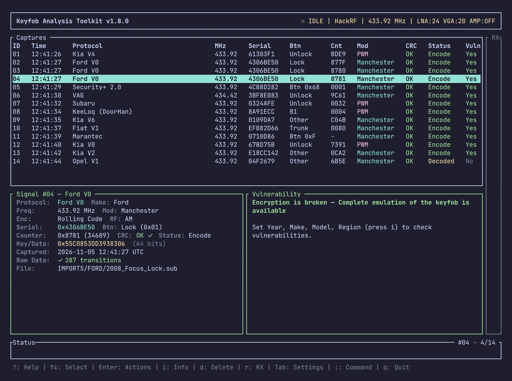

# KAT — Keyfob Analysis Toolkit

KAT captures, decodes and retransmits car key fob and garage door, gate and barrier remote signals from a terminal. It works with a **HackRF One** (receive and transmit), an **RTL-SDR** dongle (receive only) and a **Flipper Zero** on USB (receive and transmit through its console), several at once, each on its own frequency, and decodes IQ recordings and Flipper Zero `.sub` files with no radio attached. It is written in Rust, with a [ratatui](https://ratatui.rs) interface.

Its 149 protocol decoders follow [ProtoPirate](https://protopirate.net/ProtoPirate/ProtoPirate), [Flipper-ARF](https://github.com/D4C1-Labs/Flipper-ARF), [doctor-firmware](https://github.com/thedoctorz/doctor-firmware), [Momentum](https://github.com/Next-Flip/Momentum-Firmware), [RogueMaster](https://github.com/RogueMaster/flipperzero-firmware-wPlugins) and FoxFW, with receive-only decoders from [rtl_433](https://github.com/merbanan/rtl_433) for remotes no Flipper firmware reads, and each one is checked against the reference C code compiled on a PC.

**Website: [kat.karazajac.io](https://kat.karazajac.io)**, with a page for every protocol.



---

## Security and legal disclaimer

**Use KAT only on systems and vehicles you own or have explicit, written permission to test.** Capturing, decoding, or transmitting keyfob and vehicle-access signals without authorization may be illegal in your jurisdiction (e.g. computer misuse, unauthorized access, or radio regulations). You are solely responsible for ensuring your use complies with all applicable laws. KAT is intended for security research, authorized penetration testing, education, and legitimate testing on your own equipment. The authors and contributors assume no liability for misuse or damage arising from use of this software.

---

**Contents:** [Features](#features) · [Installation](#installation) · [Quick start](#quick-start) · [Command line](#command-line) · [Using the TUI](#using-the-tui) · [Configuration](#configuration) · [Supported protocols](#supported-protocols) · [How it works](#how-it-works) · [Documentation](#documentation) · [Call for researchers](#call-for-researchers) · [Credits](#credits) · [License](#license)

## Features

**Receive**

- **HackRF, RTL-SDR or a recording** — one receive chain for all three, AM/OOK and FM/2-FSK. A wide-band detector finds fobs anywhere in the received band (at 2 MS/s from 1.15 MHz below to 0.65 MHz above the tuned frequency, two at once included), and each burst is filtered and sliced around its own carrier, so fobs decode up to ±325 kHz off frequency ([docs/radio.md](docs/radio.md)).
- **A Flipper Zero as the radio** — plugged in over USB, with no app to install: KAT reads the pulses its receiver streams (`subghz rx_raw`), cuts each decoded frame out of the receiver's noise and lists it like an SDR's, and transmits its own encoders' output as a RAW `.sub` played with `subghz tx_from_file` (OOK or 2-FSK). FM reception needs doctor-firmware ([docs/flipper_radio.md](docs/flipper_radio.md)).
- **Several radios at once** — every HackRF, RTL-SDR and Flipper Zero plugged in, each tuned on its own (frequency, gains, hopping, recording): listen on 315 and 433.92 MHz at once, or transmit with one radio while another listens and shows the transmission decodes. The header has a line per radio, each capture says which radio heard it, and `:radios` lists what is plugged in and what each can do ([docs/radio.md](docs/radio.md#several-radios)).
- **Frequency hopping** — `:hop` cycles Flipper's hopper list (315.00, 390.00, 430.50, 433.92, 434.25, 434.42, 868.35 MHz) and stays on a frequency while a signal is on air, like ProtoPirate.
- **IQ recordings** — decode `.cs8` (hackrf_transfer), `.cu8` (rtl_sdr / rtl_433) and `.cf32` recordings without a radio, and record the raw IQ while receiving (`:record`).

**Decode**

- **149 protocols** — 80 car key fob and alarm protocols and 69 garage door, gate, barrier, shutter, doorbell, sensor and key-finder remote protocols ([the full list](#supported-protocols)), and Flipper-ARF's MARELLI key files.
- **KeeLoq keystore fallback** — a signal no protocol claims is tried as KeeLoq with every manufacturer key in the embedded keystore and in your own `keeloq_mfcodes_user` ([docs/keeloq.md](docs/keeloq.md)).
- **Signal detail** — encoding, RF modulation, encryption, serial, button, counter, key data, CRC (OK or FAIL where the protocol has a check KAT verifies; "none" where it has not: the fixed-code gate remotes, Fiat V0/V2, Ford V2/V3, Mercedes V0, Mitsubishi V0, Subaru, a KeeLoq frame no key identifies, Faac SLH without its seed, Scher-Khan's non-PRO variants …), frequency and the raw level/duration pairs.
- **Unknown signals** (listed by default) — unidentified signals are listed too, ready to analyze (`a`); `show_unknown_signals = false` lists only decoded ones.
- **Duplicates** — a decoded signal already in the list is not added again; with `ignore_duplicates = false` every press is listed, as a Flipper's receive history lists it ([Configuration](#configuration)).

**Transmit** (HackRF or Flipper Zero)

- **Lock, Unlock, Trunk and Panic** from a decoded capture. Rolling-code protocols re-encode the next code with the requested button wherever the references do (e.g. VAG, Subaru, Chrysler V0, Kia, Ford, Mazda, Renault V0, Sheriff CFM); protocols without an available key re-send the captured frame, as the references do.
- **Gate and garage remotes** — **Send next code**, and **Send button…** with any of the remote's native buttons.
- **Replay** any capture as recorded.
- **The references' modulation** — FM protocols go out as continuous-phase 2-FSK at the references' deviation, OOK ones as OOK, at a configurable TX power ([docs/transmit.md](docs/transmit.md)).
- **Add Manually** — `:new` creates a new gate or garage remote to pair with a receiver: any of Flipper-ARF's, doctor-firmware's, RogueMaster's and FoxFW's 112 types (86 available in KAT), with a fresh serial, the manufacturer key and a first code computed as the references do ([docs/add_manually.md](docs/add_manually.md)).

**Recover keys**

- **KeeLoq magic serial** — Flipper-ARF's KeeLoq Decrypt: finds the manufacturer key of a KeeLoq remote KAT has no key for from two captures of it, on every core — about 5 s per type for types 6 and 7, about 20 minutes for type 8 on an 8-core laptop. The key is saved, and the remote then decodes and transmits ([docs/keeloq.md](docs/keeloq.md)).
- **PSA (Peugeot/Citroën)** — ProtoPirate's TEA key brute force (BF1 and BF2), in under a second, and by default without being asked: every undecrypted PSA frame, received live, from an IQ recording or a file, gets the search in the background and, with its key, its serial, button and counter, export and transmit (`autobf`). The capture shows the key as recovered, or that no key fits.
- **HiTag2 (Fiat V1, Renault V1, Fiat V2)** — the HiTag2 Hell attack, ported from qDoctor's C: finds the 48-bit key of a remote KAT has no key for from two captures of it (two presses), on every core — about 20 minutes for a full search on a 16-thread CPU with AVX2, half that on average. The key is saved per remote in `hitag2_keys.txt` (Flipper-ARF's and doctor-firmware's file), and the remote then transmits fresh codes instead of replays ([docs/hitag2_hell.md](docs/hitag2_hell.md)).

**Files**

- **`.fob`** — KAT's JSON format: signal fields, vehicle metadata and optionally the raw pulses ([format below](#capture-metadata-and-fob-export)).
- **Flipper Zero `.sub`** — RAW and BinRAW captures, and key files: the decoded form ProtoPirate, Flipper-ARF and doctor-firmware save, so a Flipper can load and send KAT's decodes and KAT can transmit a Flipper's. The file's CC1101 preset is kept for transmit and re-export ([docs/flipper_key_files.md](docs/flipper_key_files.md)).
- **Headless decoding** — `kat --decode` prints the decodes of files and folders without the TUI, for scripts and for checking capture collections.

**Analyse**

- **Analyze** — `a` on any capture, decoded or not, works out what the signal is: OOK or FSK (measured on a HackRF or RTL-SDR: the two tones, the carrier's offset, the level), the pulse widths of each level, the base TE, the line coding (PWM, PPM, Manchester, NRZ), the frames and how they repeat, a trial decode of the bits, a drawn waveform and the raw durations ([docs/analyze.md](docs/analyze.md)). A decoded capture is also compared with its protocol's timing, as ProtoPirate's Timing Tuner does ([docs/timing_analysis.md](docs/timing_analysis.md)); an unknown one gets KAT's protocols with similar widths.
- **Compare** — `c` lines up the frames of one remote's presses, bit under bit, and says what each bit does from press to press: fixed, part of a counter, following the button, or changing with no pattern (encrypted, a checksum). It compares the decoded data and the bits as sent, so it shows where the serial, the counter and the button of a signal no decoder knows are ([docs/compare.md](docs/compare.md)).
- **Filter and sort** — `/` narrows the captures list to the captures that fit the words typed (protocol, frequency, serial, button …) and `s` sorts it by a column, for a list that several radios fill at once ([below](#filter-and-sort)).
- **Saved-fob matching** — a capture that matches one of your `.fob` files (ProtoPirate's rules: protocol, serial or key, counter within ±50) gets a ★ and shows the saved vehicle.
- **Vulnerability database** — capture metadata (year, make, model, region) is matched against a built-in CVE list ([below](#vulnerability-database)).
- **Session autosave** — captures are saved as they arrive and offered for restore at the next start ([docs/session.md](docs/session.md)).

## Installation

### Prebuilt binaries

Releases from v1.5.0 on have ready-to-run binaries on the [releases page](https://github.com/KaraZajac/KAT/releases), each with a `.sha256` checksum:

| Archive | Runs on |
|---|---|
| `kat-<version>-x86_64-linux.tar.gz` | 64-bit Intel/AMD Linux with glibc 2.35 or newer (Ubuntu 22.04, Debian 12 and later) |
| `kat-<version>-aarch64-linux.tar.gz` | 64-bit ARM Linux with glibc 2.35 or newer, such as 64-bit Raspberry Pi OS bookworm |
| `kat-<version>-aarch64-macos.tar.gz` | Apple Silicon Macs |
| `kat-<version>-x86_64-windows.zip` | 64-bit Windows 10 and 11 (since v1.8.1) |

KAT needs the HackRF library at runtime, even if you only use an RTL-SDR. Installing it brings libusb along:

```bash
sudo apt install libhackrf0     # Debian / Ubuntu / Raspberry Pi OS
sudo dnf install hackrf         # Fedora
sudo pacman -S hackrf           # Arch Linux
brew install hackrf             # macOS
```

On Windows there is nothing to install here: the `.zip` carries the HackRF library and libusb next to `kat.exe`. The radio needs a WinUSB driver instead ([Radio hardware](#radio-hardware)).

Then check, unpack and run (with your version and platform):

```bash
sha256sum -c kat-v1.12.0-x86_64-linux.tar.gz.sha256    # macOS: shasum -a 256 -c …
tar xzf kat-v1.12.0-x86_64-linux.tar.gz
./kat-v1.12.0-x86_64-linux/kat
```

On Windows, in PowerShell (Windows Terminal):

```powershell
$want = (Get-Content kat-v1.12.0-x86_64-windows.zip.sha256).Split(' ')[0]
(Get-FileHash kat-v1.12.0-x86_64-windows.zip).Hash -eq $want    # True
Expand-Archive kat-v1.12.0-x86_64-windows.zip .
.\kat-v1.12.0-x86_64-windows\kat.exe
```

The macOS binary isn't notarized, so macOS may block its first start; `xattr -d com.apple.quarantine kat` clears that. The Windows build isn't signed, so SmartScreen may stop its first start ("More info", then "Run anyway"). Intel Macs and other platforms build from source.

### Building from source

You need Rust 1.88 or newer ([rustup](https://rustup.rs)) and the HackRF library with its headers. The library is needed to build KAT even if you only use an RTL-SDR.

```bash
brew install hackrf                                          # macOS
sudo apt install libhackrf-dev pkg-config libusb-1.0-0-dev   # Debian / Ubuntu / Raspberry Pi OS
sudo dnf install hackrf-devel pkg-config libusb1-devel       # Fedora
sudo pacman -S hackrf libusb                                 # Arch Linux
```

On Windows, build in an [MSYS2](https://www.msys2.org) UCRT64 shell, which has Rust and the HackRF library: `pacman -S --needed mingw-w64-ucrt-x86_64-{toolchain,rust,pkgconf,libusb,hackrf}`, then the commands below. `kat.exe` needs `libhackrf.dll`, `libusb-1.0.dll` and `libwinpthread-1.dll` from `/ucrt64/bin` next to it (or that folder on the `PATH`).

```bash
git clone https://github.com/KaraZajac/KAT.git
cd KAT
cargo build --release
```

The binary is `target/release/kat`. Use a release build for live receive and IQ decoding: a debug build is about 20 times slower.

### Radio hardware

- **HackRF One** (or compatible) — receive and transmit.
- **RTL-SDR** dongle — receive only.
- **Flipper Zero** on USB — receive and transmit through its console; decoded signals only (no signal meter, `:record` or hopping), FM reception with doctor-firmware ([docs/flipper_radio.md](docs/flipper_radio.md)). Close qFlipper first; on Linux, join the `dialout` group.

KAT uses every radio it finds; `device` in `config.ini` limits it to some kinds. Starting KAT opens none of them: an SDR is opened for each receive run and each transmission, a Flipper's console the first time you receive or transmit with it (so qFlipper or another program can keep using a Flipper you do not use in KAT). With no radio, it warns at startup and then runs without one: you can still open, decode, analyse and export captures. The warning names the reason for each kind — not found, no USB permission (install the udev rules your HackRF or rtl-sdr package provides), or in use by another program — and `~/.config/KAT/kat.log` has the details. The header shows the radio in use: **HackRF**, **RTL-SDR (RX only)**, **Flipper Zero** or **No device** (status DISCONNECTED, in red).

**Several radios.** With more than one radio the header has a line for each, the RX meter a column for each, and the captures list a Radio column. The keys and commands that tune a radio (`r`, `:freq`, `:lna`, `:vga`, `:amp`, `:hop`, `:record`, the `Tab` settings) act on the selected one, marked ▸: pick it with `1`–`9`, `:radio <n>` or the settings' Radio tab. Each radio has the settings of its kind: a HackRF its LNA, VGA and amplifier, an RTL-SDR one gain, a Flipper Zero the frequency alone. `R` starts or stops them all. One radio transmits, marked TX: the first HackRF, else a Flipper; `:txradio <n>` or `tx_radio` in `config.ini` chooses another. It alone pauses receiving to transmit, and a capture another radio hears while it transmits nearby is KAT's own transmission, marked "Own TX". `:radios` lists every radio with its serial number or port and looks for ones plugged in since. Each radio starts on `default_frequency` with the default gains unless a `[radio.<kind>]` or `[radio.<kind>.<serial>]` section says otherwise ([Configuration](#configuration), [docs/radio.md](docs/radio.md#several-radios)).

If a receiver stops by itself (the device is busy, refuses a setting or is unplugged), the status line says "Receiver stopped: … (r restarts)" and `r` starts it again; with several radios it names the radio.

On Linux, the kernel's DVB-T driver can claim an RTL-SDR before KAT does; unload it with `sudo rmmod dvb_usb_rtl28xxu` or blacklist it (see [rtl-sdr-rs](https://crates.io/crates/rtl-sdr-rs)).

On Windows, libusb only opens a radio that has the WinUSB driver. Install it once with [Zadig](https://zadig.akeo.ie): Options → List All Devices, select the HackRF One (an RTL-SDR shows as "Bulk-In, Interface (Interface 0)"), choose WinUSB, Install Driver. Without it, KAT's startup warning says "install its WinUSB driver with Zadig". `~/.config/KAT` is `C:\Users\<you>\.config\KAT` on Windows.

## Quick start

1. Connect the radio and start KAT: `kat` (`target/release/kat` when built from source).
2. Press `r` to start receiving. KAT listens on 433.92 MHz by default; `:freq 315` changes the frequency and `:hop on` hops over the common key fob frequencies.
3. Press a button on the fob. Each frame it sends appears in the captures list (a press that repeats one frame is one capture), decoded when KAT knows the protocol.
4. Move through the list with `j` / `k` or the arrow keys; the detail panel shows the selected capture. `/` filters the list and `s` sorts it.
5. Press `Enter` for the capture's actions: transmit, export, analyze, key recovery. `a` analyzes it straight away, also a signal no decoder knows, and `c` compares the presses of its remote: which bits are fixed, count or follow the button.
6. Press `Tab` for the radio settings, `:` for commands (`:load` opens files and recordings), and `q` to quit.

## Command line

```bash
kat                                         # start the TUI
kat --iq fob.cs8 --freq 433.92 --rate 2M    # also decode an IQ recording at startup
kat --decode IMPORTS/ fob.cu8 --rate 250k   # decode files and folders without the TUI
kat --keeloq-bf captures/ --save            # recover a magic-serial KeeLoq key (--type auto|6|7|8)
kat --help                                  # all options; --version prints the version
```

`--decode` prints `file | frequency | source | protocol | xcount | data=…/bits sn= btn= cnt= crc= tx=` per distinct decode (with `autobf`, an undecrypted PSA frame's line ends `key=BF1` / `key=BF2` with the fields its key decrypts, or `key=none`) (`source` is `raw`, `key`, or the IQ path `am`/`fm`); `--all` prints every decode in stream order, `--verbose` also dumps each IQ burst (time, length, SNR, carrier offset, FSK deviation, pulses) to stderr. Files whose name carries no rate (e.g. rtl_433 `gfile001.cu8`) need `--rate`.

`--freq` and `--rate` default to values in the recording's file name (e.g. `kat_433670000Hz_2000000sps_….cs8`), else the configured frequency and 2 MS/s. `--rate` takes 200 kS/s to 40 MS/s; `--iq` takes IQ recordings (`.cs8`, `.cu8`, `.cf32`) — `.sub` files go to `--decode`, or open in the app with `:load`. `-d` and `-v` are short for `--decode` and `--verbose`.

Exit status: `0` on success; `1` when `--decode` could not read a file or found nothing to decode (an empty folder, or only `.fob` files), or `--keeloq-bf` found no key; `2` for a bad argument or a missing `--iq` / `--keeloq-bf` file. `--keeloq-bf` shows its progress line only on a terminal.

## Using the TUI

### Keys

| Key | Action |
|---|---|
| `j` / `k` or `↓` / `↑` | Move through the captures |
| `PgUp` / `PgDn`, `Home` / `End` (or `g` / `G`) | Move a page, or to the first / last capture |
| `Enter` | Open the selected capture's action menu (it stays on that capture while new ones arrive) |
| `i` | Edit the capture's metadata: year, make, model, region and command (used by the CVE match and `.fob` export). `Tab` / `↓` and `Shift-Tab` / `↑` move between the fields, `Enter` goes to the next one and saves on the last (the export form works the same) |
| `a` | Analyze the selected capture: keying, pulse widths, TE, line coding, frames and bits ([docs/analyze.md](docs/analyze.md)) |
| `c` | Compare the presses of the selected capture's remote: which bits stay fixed, count, follow the button or change with no pattern. In the report `Tab` changes between the decoded data and the bits as sent ([docs/compare.md](docs/compare.md)) |
| `/` | Filter the list: it narrows while you type; `Enter` keeps the filter, `Esc` goes back to the one before ([below](#filter-and-sort)) |
| `s` / `S` | Sort the list by the next column / reverse the order |
| `d` | Delete the selected capture |
| `u` | Undo the last delete (`d`, `:delete`, `:delete all`) |
| `r` | Start or stop receiving (with several radios, on the selected one) |
| `R` | Start or stop every radio |
| `1`–`9` | Select a radio (several radios): the one `r`, `Tab` and the radio commands tune |
| `Tab` | Radio settings: choose a setting with `←` / `→` (or `Tab` / `Shift-Tab`), `Enter` to change it, `↑` / `↓` to pick a value, `Enter` to apply. The bar has the settings the selected radio has: LNA, VGA and AMP for a HackRF, one Gain for an RTL-SDR, the frequency alone for a Flipper Zero, and TX power when a HackRF transmits. A value set by command that is not in the list (`:freq 433.42`) shows as the first row, "(current)" |
| `:` | Command line |
| `?` or `F1` | Help (also `:help`) |
| `Esc` | Close a menu, form or overlay; in the list, clear the message and cancel the transmissions still queued, and with neither there, clear the filter |
| `q` or `Ctrl-C` | Quit (also `:q`); asks first while a key search, an IQ file, a recording or a transmission is running. In menus, forms and prompts `Ctrl-C` works as `Esc` |

A new capture is selected only when the selection is on the last row (or nothing is selected) and no menu or form is open, so it never moves the selection you are working with. In a list sorted by a column it is never selected, and under a filter only when it fits.

Where you type (the command line, the list's filter, the forms, the filter of `:new`), `Ctrl-U` clears the text and `Ctrl-W` or `Alt-Backspace` deletes its last word. The status bar shows the last message, errors in red; one too long for its line wraps, and the bar grows to three lines for it when the terminal has the rows.

### Filter and sort

`/` opens the filter line (`:filter <words>` sets the same filter). A capture is shown when every word fits it, in any case:

| Word | Shows the captures… |
|---|---|
| `kia` | with it in the protocol, frequency (as listed: `433.92`), radio, serial, button, status, make or model |
| `serial:1a2b` | with it in that column. Every column has a name: `id`, `time`, `protocol`, `mhz`, `radio`, `serial`, `btn`, `cnt`, `mod`, `crc`, `status`, `vuln`, and `make`, `model`, `file` of the capture's details (`proto`, `freq`, `button`, `counter` work too) |
| `!unknown`, `!btn:lock` | without it |
| `#7`, `id:7`, `id:3-9` | with that ID, or an ID in that range |

`kia unlock 433.92` shows the Unlock presses of Kia remotes on 433.92 MHz. The list's title says how many captures are shown and the filter ("Captures · 5 of 25 · filter: kia unlock"). `Esc` in the list or `:filter` alone clears it. A file you load, or a remote made with `:new`, that the filter would hide clears it too, so what you added is in front of you.

`s` sorts by the next column of the list, back to the order of arrival after the last; `S` reverses the order. `:sort serial`, `:sort cnt desc` sort by a column by name, `:sort` alone goes back to the order of arrival. Captures with nothing in the column (no serial, no counter) come last either way, and equal ones stay in the order they arrived. The title names the sort ("sort: Serial ▲").

The keys work on what the list shows: moving, `Home` / `End`, `←` / `→` in Analyze, and `c`, which compares the shown captures of a remote. IDs do not change, and a command takes a capture by its ID whether it is shown or not.

### Signal actions

`Enter` on a capture opens its actions. With only RTL-SDRs or no radio, the transmit actions are not offered (the menu's border says "TX: needs a HackRF or a Flipper"); while the transmitting radio records (`:record`), transmitting is refused (it would stop that receiver and end the recording).

After an encoder transmission (Send next code, Send button…, TX Lock … Panic) a rolling code's capture keeps the code it sent — counter, frame and button — so the next press sends the one after and the session autosave remembers it, as Flipper-ARF, doctor-firmware and ProtoPirate keep the last code they sent ([docs/transmit.md](docs/transmit.md#after-a-transmission)). Exports never replace a file (a name in use gets `_2`, `_3`, …), end with "Exported to <full path>", and a failed one is reported in the status line.

| Action | Description |
|---|---|
| Recover key (KeeLoq magic serial) | KeeLoq frame no key decrypts: search the remote's magic-serial manufacturer key using all of its captures (two or more presses), on every core (Flipper-ARF's KeeLoq Decrypt). The key is saved as `BF_<serial>` and the remote's captures decode ([docs/keeloq.md](docs/keeloq.md)) |
| Recover key (PSA brute force) | PSA TEA frame without a key: run ProtoPirate's key brute force in the background (with `autobf`, the default, it already ran on its own). On success the capture gets its serial, button and counter, and transmit actions; the detail panel says how the key was recovered, or that no key fits |
| Recover key (HiTag2) | Fiat V1, Renault V1 or Fiat V2 frame KAT has no key for (it would be replayed): search the remote's key with HiTag2 Hell, paired with another capture of the same remote (same UID, another press), on every core, about 20 minutes at most. The key is saved in `hitag2_keys.txt` and the remote's captures send fresh codes ([docs/hitag2_hell.md](docs/hitag2_hell.md)) |
| Cancel key recovery | Stop a running key recovery (its progress shows in the status bar's title) |
| Replay | Re-transmit the capture as recorded (the capture does not change) |
| Send next code | Gate, garage and barrier remotes (instead of TX Lock … Panic): transmit the code after the stored one, which the capture then keeps, so each press sends a new code |
| Send button… | Gate and garage remotes: pick one of the remote's native buttons, or type a hex code, and send the next code with it (the capture keeps it; the list stays open) |
| TX Lock / TX Unlock / TX Trunk / TX Panic | Car remotes KAT can encode: transmit the next code with that button (the capture keeps it) |
| Export .fob | Save the capture with vehicle metadata ([below](#capture-metadata-and-fob-export)) |
| Export .sub (Flipper) | Save the raw capture as a Flipper Zero RAW `.sub`, with the capture's preset |
| Export Flipper key (.sub) | Save the decode as a Flipper key file (`<name>_key.sub`), as ProtoPirate and Flipper-ARF save it |
| Analyze | What the signal is: OOK or FSK, pulse widths, TE, line coding, frames, a trial decode of the bits, the waveform; for a decoded capture also its timing against the protocol's definition (ProtoPirate's Timing Tuner). Offered for unknown captures too. In the report `←` / `→` show the captures next to this one |
| Delete Signal | Remove the capture from the list |

### Commands

Press `:` and type a command (`:help` lists them); the command word works in any case. `↑` / `↓` bring back the commands run before in this run of KAT; `Esc`, or `Backspace` on the empty line, closes the line. `<ID>` is one or more capture IDs or ranges, separated by commas or spaces: `1`, `#4`, `1,3,5`, `1 3 5`, `1-5`, `5-1` (backwards). A command given several ends with a summary such as `Replayed 3 of 5 (#04, #05 not found)`. Transmit commands need a HackRF or a Flipper Zero; while several transmissions run, the status bar counts them and `Esc` cancels the rest. With several radios, the receive commands (`:freq`, `:hop`, `:lna`, `:vga`, `:amp`, `:record`) set the selected one.

| Command | Description |
|---|---|
| `:radios` | List the radios: what each does now, its serial number or port and settings, the frequencies each kind tunes, and why a kind is not in use; radios plugged in since KAT started are added |
| `:radio <n\|name>` | Select a radio by its number or name (`:radio 2`, `:radio rtl-sdr`); no argument says which one is selected |
| `:txradio <n\|name>` | Choose the radio that transmits; no argument says which one does |
| `:freq <MHz>` | Set the receive frequency (e.g. `:freq 433.92`; `433.92M`, `433.92 MHz`, `433920000` and `433920000Hz` work too, as in `:hop` and `:iq`) |
| `:hop on` / `:hop off` | Frequency hopping over the hop list; KAT stays on a frequency while a signal is on air |
| `:hop <MHz> <MHz> …` | Set the hop list (`:hop default` restores Flipper's list; `:hop dwell <ms>` sets the time per quiet frequency) |
| `:lna <0-40>` / `:vga <0-62>` / `:amp [on\|off]` | A HackRF's receive gains and RF amplifier (`:amp` alone toggles it): LNA in 8 dB steps, VGA in 2 dB steps; a value in between goes to the step below, and the message says so. An RTL-SDR has one gain, which `:vga` sets; a Flipper Zero has none (its receive preset sets them), and the commands a radio has no use for say so |
| `:txpower <0-47> [amp on/off]` | TX VGA gain and RF amp for every transmission of a HackRF (a Flipper Zero sends at its own power); no argument shows the setting |
| `:iq <file> [MHz] [rate]` | Decode a `.cs8` / `.cu8` / `.cf32` IQ recording in the background (no radio needed); `:iq stop` cancels |
| `:record [file]` / `:record stop` | Record the raw IQ as received to the export folder (`.cs8` for HackRF, `.cu8` for RTL-SDR) |
| `:load [file\|dir]` | Import a `.fob` or `.sub` file, or decode an IQ recording; a directory, or no argument, opens the file browser there. A path is looked up as given, then in the import and export folders; quotes and `~` work (`:load "My Fob.sub"`). In the browser `←` / `Backspace` go to the parent folder and `→` opens a folder |
| `:lock <ID>` / `:unlock <ID>` / `:trunk <ID>` / `:panic <ID>` | Transmit that button's next code |
| `:replay <ID>` | Replay the raw capture(s) in order |
| `:new [type…]` | Create a new gate/garage remote ("Add Manually"): opens the type picker, or creates the one type the words name (e.g. `:new princeton 433`) |
| `:klbf [ID] [auto\|6\|7\|8]` | Recover the magic-serial KeeLoq key of a remote (default: the selected capture, Auto = types 6 and 7); `:klbf stop` cancels |
| `:analyze [ID]` | Analyze a capture (default: the selected one); `:timing` is the older name and still works |
| `:compare [IDs]` | Compare the presses of the selected capture's remote, or the captures named, in the order named (`:compare 1-5`); `:compare 1-5 / 6-10` compares two groups in place of the buttons. `:cmp` is short for it ([docs/compare.md](docs/compare.md)) |
| `:filter [words]` | Show only the captures that fit the words ([Filter and sort](#filter-and-sort)); `:filter` alone shows all again |
| `:sort [column] [desc]` | Sort the list by a column (`:sort serial`, `:sort cnt desc`); `:sort` alone is the order of arrival |
| `:delete <ID>` / `:delete all` | Delete captures (`:delete all` asks first); `u` in the list brings back the last deleted. `:del` is short for it |
| `:clear` | Clear all captures and delete the saved session and its backup (`session.json`, `session.json.bak`); asks first, cannot be undone |
| `:help` or `:?` | Keys and commands (also `?` or `F1`) |
| `:license` / `:credits` | Show the license or the credits |
| `:q` or `:quit` | Quit (asks first while work is running); `:x`, `:exit` and `:wq` do the same, `:q!` quits without asking |

### Capture metadata and .fob export

When exporting to `.fob`, a metadata form collects filename and optional vehicle info:

- **File** — output filename (extension added by format). It starts as `Year_Make_Model_Region_Command_8HEX`: a detail that is not set reads `Unknown`, and the 8 hex digits (e.g. `A1B2C3D4`) give each export a file of its own. The name follows the vehicle details as you fill them in, until you edit the name itself.
- **Year** — vehicle model year
- **Make** — manufacturer (auto-suggested from protocol)
- **Model** — vehicle model
- **Region** — region/market
- **Command** — button/command label (e.g. Unlock, Lock, Trunk, Panic); used in the default filename and stored in the .fob vehicle section.
- **Notes** — free-form notes

The exported `.fob` file is a versioned JSON document (v2.0, format `kat-fob`) containing:

```json
{
  "version": "2.0",
  "format": "kat-fob",
  "signal": {
    "protocol": "Kia V3/V4",
    "frequency": 433920000,
    "frequency_mhz": "433.92MHz",
    "modulation": "PWM",
    "rf_modulation": "AM/FM",
    "encryption": "KeeLoq",
    "data_bits": 64,
    "data_hex": "...",
    "serial": "0x1A2B3C",
    "key": "0x...",
    "button": 1,
    "button_name": "Lock",
    "counter": 1234,
    "crc_valid": true,
    "encoder_capable": true
  },
  "vehicle": {
    "year": 2023,
    "make": "Kia",
    "model": "Sportage",
    "region": "NA",
    "command": "Lock",
    "notes": ""
  },
  "capture": {
    "timestamp": "2026-02-07T12:00:00Z",
    "raw_data_hex": "0x...",
    "raw_pair_count": 0,
    "raw_pairs": [{"level": true, "duration_us": 400}, {"level": false, "duration_us": 800}]
  }
}
```

- **vehicle.command** — optional; user-editable command label (e.g. Unlock, Lock). Set in the export form or via **i** (capture metadata). Used in the export's default filename (`Year_Make_Model_Region_Command_8HEX.fob`).
- **rf_modulation** — AM, FM, or AM/FM per protocol (from ProtoPirate). Omitted when unknown.
- **Optional signal fields (1.5)** — `data_extra` (encoder state for frames over 64 bits), `received_rf` (the path KAT received it on: AM or FM), `preset` with `custom_preset_module` / `custom_preset_data` (the Flipper preset the signal was recorded or will be sent with) and `tx_modulation` (informational, e.g. `2-FSK ±47.61 kHz`). Files without them still load.
- **capture** — `raw_data_hex`, `raw_pair_count`, and optionally `raw_pairs` when config `include_raw_pairs` is true.

## Configuration

On first start KAT creates its folder and a commented `config.ini`:

```
~/.config/KAT/
├── config.ini            # Settings (written with comments on first start)
├── session.json          # Autosaved captures (owner-only; see docs/session.md)
├── keeloq_mfcodes_user   # Your KeeLoq manufacturer keys, Flipper format; recovered keys are added here
├── hitag2_keys.txt       # HiTag2 keys per remote (Flipper-ARF / doctor-firmware format); recovered keys are added here
├── exports/              # .fob and .sub exports
└── import/               # .fob and .sub files imported at startup
```

Nice FloR-S and Alutech AT-4N need their tables there to decode and transmit fully (`nice_flor_s.bin`, `alutech_at_4n.bin`; see their docs).

Example `config.ini` (all keys optional; defaults are used if missing):

```ini
[general]
export_directory = ~/.config/KAT/exports
import_directory = ~/.config/KAT/import
max_captures = 100
show_unknown_signals = true
ignore_duplicates = true
autobf = true

[radio]
default_frequency = 433920000
default_lna_gain = 24
default_vga_gain = 20
default_amp = false
hop_frequencies = 315.00, 390.00, 430.50, 433.92, 434.25, 434.42, 868.35
hop_dwell_ms = 100
tx_vga_gain = 47
tx_amp = true
device = auto
tx_radio = auto
; flipper_port = /dev/ttyACM0
; flipper_preset = FM476

; Optional: how single radios, or every radio of a kind, start
[radio.rtlsdr]
frequency = 315
vga_gain = 32

[radio.hackrf.2e5a1f3d]
frequency = 868.35

[export]
default_format = fob
include_raw_pairs = true

[session]
session_autosave = true
```

Switches take `true`/`false`, `yes`/`no`, `on`/`off` or `1`/`0`. A value KAT cannot use, an unknown key (a typo such as `default_frequncy`) or an export/import folder that cannot be created (an unplugged SD card) is reported at startup in the status line and in `kat.log`, and the default is used instead.

- **import_directory** — directory scanned at startup for .fob and .sub files to import (default `~/.config/KAT/import`). Exports are still saved to **export_directory**.
- **default_frequency** — MHz (`433.92`) or Hz (`433920000`), 300–928 MHz.
- **default_lna_gain / default_vga_gain** — fitted to what the radio takes: LNA 0–40 dB in 8 dB steps, VGA 0–62 dB in 2 dB steps (rounded down). An RTL-SDR has one tuner gain and takes the VGA value for it; a Flipper Zero's gain is its receive preset's.
- **show_unknown_signals** — when `true` (default), unknown (unidentified) signals are listed with the decoded ones; when `false`, only signals a protocol decodes appear, live, from IQ files and from imports. Older versions called it `research_mode`, which is still read when `show_unknown_signals` is absent.
- **autobf** — when `true` (default), KAT recovers the key of every capture a brute force can crack without being asked: each undecrypted PSA (TEA) frame gets ProtoPirate's BF1/BF2 search in the background, and the frames of PSA's adaptive AM path that only the search can confirm are listed once their key is found. `false`: only the **Recover key** action runs it.
- **ignore_duplicates** — when `true` (default), a decoded signal already in the list (same protocol, data, serial and button) is not added again. When `false`, every press is listed, as a Flipper's receive history does: a signal is only merged with the same one on the air less than 500 ms before it (one press still going, the AM and FM paths both reporting it, or both sides of a long transmission's cut). Importing a file again then adds its captures again.
- **include_raw_pairs** — when `true`, .fob exports include raw level/duration pairs for replay.
- **hop_frequencies / hop_dwell_ms** — the `:hop` list (MHz) and the time spent on a quiet frequency.
- **tx_vga_gain / tx_amp** — transmit power (0–47 dB TX VGA, RF amp); the defaults are the HackRF's maximum, as in KAT ≤ 1.4.
- **device** — the radios KAT uses: `auto` (every HackRF, RTL-SDR and Flipper Zero it finds), or the kinds to use, such as `hackrf, rtlsdr`.
- **tx_radio** — the radio that transmits: `auto` (the first HackRF, else a Flipper), `hackrf` or `flipper`, followed by a serial number (or its last digits, as `:radios` shows them) when there are two of a kind: `tx_radio = hackrf 2e5a1f3d`. Also `:txradio` while KAT runs.
- **[radio.&lt;kind&gt;] / [radio.&lt;kind&gt;.&lt;serial&gt;]** — how radios start: `frequency`, `lna_gain`, `vga_gain` and `amp` (a HackRF has them all; an RTL-SDR the frequency and `vga_gain`, its one gain; a Flipper Zero the frequency) for every radio of a kind (`hackrf`, `rtlsdr`, `flipper`), or for one radio by its serial number or the serial's last digits (a Flipper also by its port). A radio's own section wins over its kind's, and both over the general defaults. Cheap RTL-SDRs often share the serial `00000001`; give each its own with `rtl_eeprom -s` to tell them apart.
- **flipper_port / flipper_preset** — a Flipper Zero's console port when KAT does not find it by its USB name, and the receive preset of doctor-firmware's `rx_raw` (`FM476`, `FM238`, `AM650`, …; other firmwares receive with their own AM preset only). See [docs/flipper_radio.md](docs/flipper_radio.md).
- **session_autosave** — autosave captures to `session.json` (default on); **max_captures** also caps the saved session.

## Supported protocols

Protocol behavior and RF modulation (AM/FM) follow the ProtoPirate reference; protocols ProtoPirate does not carry are ported from [Flipper-ARF](https://github.com/D4C1-Labs/Flipper-ARF) and [doctor-firmware](https://github.com/thedoctorz/doctor-firmware), then [Momentum](https://github.com/Next-Flip/Momentum-Firmware), [RogueMaster](https://github.com/RogueMaster/flipperzero-firmware-wPlugins) and FoxFW. Remotes no Flipper firmware reads are decoded with ports of [rtl_433](https://github.com/merbanan/rtl_433)'s decoders, receive only ([below](#receive-only-remotes-from-rtl_433)). KAT receives AM/OOK and FM/2-FSK and transmits each protocol with the modulation and FSK deviation the references use ([docs/transmit.md](docs/transmit.md)). “Replay” encoders re-send the captured rolling code (optionally re-stamping the button) because no manufacturer key is available.

### Car key fobs and alarms

| Protocol | Encoding | RF | Encryption | Frequency |
|---|---|---|---|---|
| Kia V0 / Suzuki V0 / Honda V0 / Mitsubishi V0 (61-bit) | PWM | AM/FM | Rolling Code (CRC8; encoder: counter + 1) | 315 / 433.92 MHz |
| Kia V1 | Manchester | AM | Rolling Code (CRC; encoder: counter + 1) | 315 / 433.92 MHz |
| Kia V2 | Manchester | AM/FM | Rolling Code (CRC; encoder: counter + 1) | 315 / 433.92 MHz |
| Kia V3 / Kia V4 | PWM | FM | KeeLoq (KIA key check, as in the references) | 315 / 433.92 MHz |
| Kia V5 | Manchester | FM | Rolling Code (mixer; encoder) | 315 / 433.92 MHz |
| Kia V6 | Manchester | FM | AES-128 (encoder: counter + 1) | 315 / 433.92 MHz |
| Kia V7 | Manchester | FM | Rolling Code (CRC8; encoder: counter + 1) | 315 / 433.92 MHz |
| Ford V0 | Manchester | AM | Rolling Code (7-bit matrix CRC) | 315 / 433.92 MHz |
| Ford V1 | Manchester | FM | Rolling Code (descramble + CRC16) | 315 / 433.92 MHz |
| Ford V2 | Manchester | FM | Rolling Code (plaintext 16-bit counter; encoder: counter + 1) | 315 / 433.92 MHz |
| Ford V3 (EU + US) | Manchester | AM/FM | Rolling Code (decode-only) | 315 / 433.92 MHz |
| Chrysler V0 (Dodge/Jeep) | PWM | AM | Rolling Code (seed-XOR) | 315 / 433.92 MHz |
| Honda Static | Manchester | FM | Fixed Code | 315 / 433.92 MHz |
| Honda V1 | PWM | AM | Rolling Code | 315 / 433.92 MHz |
| Honda V5 | Manchester | AM/FM | Rolling Code (CRC-8; decode-only) | 315 / 433.92 MHz |
| Toyota (Lexus) | Bi-phase (diff. Manchester) | AM | Rolling Code (7-bit counter masks; encoder) | 315 / 433.92 MHz |
| Honda V2 (formerly "Land Rover V0") | Diff. Manchester | FM | Rolling Code (3-bit check) | 315 / 433.92 MHz |
| Fiat V0 | Manchester | AM | Rolling Code (replay) | 433.92 MHz |
| Fiat V1 (Magneti Marelli BSI) | Manchester | AM | HITAG2 (PP 9 keys + ARF dictionary/heuristics + saved/recovered keys → fresh frame; replay otherwise) | 315 / 433.92 MHz |
| Fiat V2 (FCA: Fiat/Chrysler/Jeep) | Manchester | AM | Rolling Code (HITAG2 forward-encode with a known or saved/recovered key, else replay) | 315 / 433.92 MHz |
| MARELLI (Flipper-ARF key files; no decoder, as FoxFW) | Manchester | FM | Replay of saved frames (load, save, transmit) | 433.92 MHz |
| Renault V0 | Manchester | AM | Rolling Code | 315 / 433.92 / 868.35 MHz |
| Renault V1 | Manchester | AM/FM | HITAG2 (serial-derived seed auto-recovered, or a saved/recovered key → fresh frame; replay otherwise) | 315 / 433.92 / 868.35 MHz |
| Renault V1 (ARF) — Flipper-ARF type table 0x04/0x0C/0x1A/0x3B/0x3F + Dynamic | Manchester | AM/FM | Rolling Code (replay only) | 315 / 433.92 / 868.35 MHz |
| Mazda V0 | Manchester | AM/FM | XOR whitening (encoder) | 315 / 433.92 MHz |
| Mazda Siemens | Manchester | FM | Siemens XOR/interleave | 315 / 433.92 MHz |
| Mazda V2 | Diff. Manchester | AM/FM | Rolling Code (table-driven next code) | 315 / 433.92 MHz |
| Mitsubishi V0 (ARF 96-bit) | PWM | FM | Bit Negation + XOR (replay encoder) | 315 / 433.92 / 868.35 MHz |
| BMW | Manchester | AM | Rolling Code (replay) | 433.92 MHz |
| Mercedes V0 | Manchester | FM | Rolling Code (replay) | 433.92 MHz |
| Mercedes V1 | Manchester | FM | Rolling Code (replay) | 433.92 MHz |
| Opel V1 | Manchester | AM | XTEA (decode-only) | 433.92 MHz |
| GM (Chevrolet/Buick/GMC/Cadillac) | PPM | AM | Rolling Code (replay) | 315 / 433.92 MHz |
| Datsun Lada | Manchester | FM | HITAG2-family | 433.92 MHz |
| VAG Polo (VW Polo 5, FoxFW) | Manchester | AM | Rolling Code (decode-only) | 433.92 MHz |
| Chevrolet V0 (GM Open/Close, FoxFW) | Manchester | AM | Rolling Code (decode-only) | 433.92 MHz |
| Tesla Charge (FoxFW) | Manchester | AM | Fixed code (FoxFW encoder: the saved code, 5 copies) | 315 / 433.92 MHz |
| Hyundai/Kia RIO (FoxFW) | PWM | AM | Fixed code, 16-bit checksum (FoxFW encoder: button → mask, checksum recomputed) | 433.92 MHz |
| SantaFe 13-16 (FoxFW) | PWM | AM | Rolling Code, CRC-8 (FoxFW encoder: captured rolling word, button re-stamped, CRC recomputed) | 433.92 MHz |
| Hitag2 (FoxFW) | Manchester | AM | PCF7946/7947 RKE frame, XOR check (decode-only) | 433.92 MHz |
| Nidec RKE (FoxFW) | PWM | FM | Rolling Code (decode-only: FoxFW's encoder refuses every key) | 315 MHz |
| Renault/xHorse V4 (FoxFW) | Manchester | AM | Clear counter, XOR check (decode-only) | 315 / 433.92 MHz |
| Fiat Ducato V0 (FoxFW) | Manchester | AM | Rolling Code, 7-bit CRC field (decode-only) | 433.92 MHz |
| Renault V2 (FoxFW) | Manchester | AM | Rolling Code, identify-only | 315 / 433.92 MHz |
| Opel V0 (FoxFW) | Burst width | AM | Rolling Code (decode-only) | 433.92 MHz |
| Honda V4 (FoxFW) | PWM | AM | Rolling Code, inverse-byte check (decode-only) | 315 / 433.92 MHz |
| Honda V7 (FoxFW) | PWM | AM | Rolling Code, XOR checksum (decode-only) | 315 / 433.92 MHz |
| Honda V9 (FoxFW) | Manchester | AM/FM | Rolling Code, XOR checksum (decode-only) | 315 / 433.92 MHz |
| HondaV2&V3 (FoxFW) | Manchester | FM | Rolling Code, V3 CRC (decode-only) | 433.92 MHz |
| Honda V10 (FoxFW) | Manchester | AM/FM | Rolling Code (decode-only) | 315 / 433.92 MHz |
| Mitsubishi V1 (FoxFW) | Manchester | AM/FM | Rolling Code (decode-only) | 315 / 433.92 MHz |
| LDV V0 (FoxFW) | Manchester | AM | Rolling Code (decode-only) | 315 / 433.92 MHz |
| Lexus V0 (FoxFW) | Manchester | AM | Rolling Code, complement-verified (decode-only) | 315 / 433.92 MHz |
| Mazda V1 (FoxFW) | Manchester | AM | Rolling Code (decode-only) | 315 / 433.92 MHz |
| Nissan V0 (FoxFW) | Manchester | AM | Rolling Code (decode-only) | 315 / 433.92 MHz |
| Toyota (FoxFW: Prius 2006 / Tundra, KeeLoq layout) | PWM | AM | Rolling Code, button whitelist (decode-only) | 315 / 433.92 MHz |
| BMW V2 (FoxFW) | Manchester | AM | Rolling Code (decode-only) | 315 / 433.92 MHz |
| BMW/Mini V3 (FoxFW) | Manchester | AM/FM | Rolling Code (decode-only) | 315 / 433.92 MHz |
| Audi V3 (FoxFW) | Manchester | AM/FM | Rolling Code (decode-only) | 315 / 433.92 MHz |
| BMW CAS3 (FoxFW) | PWM | AM | AES rolling code (FoxFW encoder: replay of the saved frame) | 315 / 433.92 / 868 MHz |
| Porsche Cayenne (ARF “Porsche AG”) | PWM | AM | VAG rolling register (encoder) | 315 / 433.92 / 868.35 MHz |
| Subaru | PWM | AM | Rolling Code (encoder: counter + 1) | 315 / 433.92 MHz |
| VAG (VW/Audi/Seat/Skoda) | Manchester | AM | AUT64/XTEA (encoder: counter + 1, all types) | 315 / 433.92 / 434.42 MHz |
| Scher-Khan (Magic Code, PRO1/PRO2) | PWM | AM/FM | Magic Code / PRO cipher + CRC (encoder) | 315 / 433.92 MHz |
| Star Line | PWM | AM | KeeLoq (whole keystore searched; encoder: counter + 1) | 315 / 433.92 MHz |
| Sheriff CFM (ZX-750/930 alarm) | PWM | AM | KeeLoq | 315 / 433.92 MHz |
| KeeLoq (gates, garage doors, alarms) | PWM | AM | KeeLoq (keystore + your `keeloq_mfcodes_user`; per-key learning type as in Flipper-ARF; unidentified remotes listed as `KeeLoq (Unknown)`, replay only) | any band (300–868 MHz) |
| PSA (Peugeot/Citroën) | Manchester | AM/FM | TEA/XOR (TEA key via the “Recover key” brute force; encoder: counter + 1) | 315 / 433.92 MHz |

### Garage door, gate, barrier and shutter remotes

Ported from Flipper-ARF's garage app (`applications/system/subghz_garage`, its newest copies), with doctor-firmware where the app lacks a protocol or doctor can do more, and [Momentum](https://github.com/Next-Flip/Momentum-Firmware) and [RogueMaster](https://github.com/RogueMaster/flipperzero-firmware-wPlugins) for the ones they add (Hörmann BiSecur, Cardin S508, Freezer, Faac TM); every decoder matches the reference C compiled on a PC (field for field, on Flipper's unit-test captures, real recordings and fuzzed streams) and every encoder its upload pulse for pulse. They run on any frequency, like the Flipper. Their transmit actions are **Replay**, **Send next code** (counter + 1 where the protocol rolls) and **Send button…** (any of the remote's native buttons, or a typed code). `:new` creates a new remote of any of Flipper-ARF's, doctor-firmware's, RogueMaster's and FoxFW's 112 types to pair with a receiver (**Add Manually**, [docs/add_manually.md](docs/add_manually.md)). Where Flipper-ARF's garage-app TX plugins are built without their counter/button helpers (they always send button 0 or jump the counter), KAT follows the source's intended behaviour, as doctor-firmware does.

| Protocol | Encoding | RF | Code | Bands (reference flags) | TX |
|---|---|---|---|---|---|
| Security+ 1.0 / Security+ 2.0 (Chamberlain/LiftMaster) | PWM ternary / Manchester | AM | Rolling Code | 315 / 390 / 433.92 MHz | next code |
| Somfy Telis (RTS) / Somfy Keytis | Manchester | AM | Rolling Code (obfuscation + checksum) | 433.42 / 868 MHz | next code, any button |
| FAAC SLH | PWM | AM | KeeLoq (FAAC learning, seed) | 433.92 / 868 MHz | next code with the seed; programming frames |
| KingGates Stylo4k | PWM | AM | KeeLoq | 433.92 MHz | next code |
| Jarolift (shutters) | PWM | AM | KeeLoq (normal learning) | 433.92 MHz | next code |
| Beninca ARC | PWM | AM | AES-128 | 433.92 MHz | next code |
| Hörmann BiSecur (Momentum / RogueMaster) | Manchester | FM | AES-128 (frame CRC-8 checked) | 868 MHz | re-sends the stored frame (as the C) |
| Cardin S508 (RogueMaster) | Manchester | FM | AES-128 | 868 MHz | decode only (as in the C) |
| Nice FloR-S / Nice One (+ doctor's Nice O-Code keys) | PWM | AM | Rolling Code (needs `~/.config/KAT/nice_flor_s.bin`) | 433.92 / 868 MHz | next code with the table |
| CAME Atomo | Manchester | AM | Rolling Code | 433.92 / 868 MHz | next code |
| Alutech AT-4N | PWM | AM | TEA-style (needs `~/.config/KAT/alutech_at_4n.bin`) | 433.92 MHz | next code with the table |
| Ditec GOL4 | PWM | AM | Rolling Code | 433.92 MHz | next code |
| Phoenix V2, Hay21, Prastel | PWM | AM | Rolling Code | 433.92 MHz (Prastel also 315) | next code |
| iDo 117/111 | PWM | AM | Rolling Code | 433.92 MHz | decode only (as in the C) |
| CAME (12/18/24/25/42-bit) / CAME TWEE | PWM / Manchester | AM | Fixed Code | 315 / 433.92 / 868 MHz | yes |
| Nice FLO (12/24-bit) | PWM | AM | Fixed Code | 315 / 433.92 MHz | yes |
| Princeton (PT2262/EV1527), SMC5326, Holtek, Holtek HT12X | PWM | AM (HT12X AM/FM) | Fixed Code | 315 / 433.92 / 868 MHz | yes |
| Linear, Linear Delta3, MegaCode, Chamberlain Code | PWM | AM | Fixed Code | 300–390 MHz | yes |
| Hörmann HSM, Marantec, Marantec24 | PWM / Manchester | AM | Fixed Code (Marantec CRC-8) | 433.92 / 868 MHz | yes |
| GateTX, BETT, Doitrand, Clemsa, Mastercode, Ansonic, Dickert MAHS, Elplast, Roger | PWM | AM (Ansonic AM/FM) | Fixed Code | 315 / 433.92 / 868 MHz | yes |
| Nero Sketch, Nero Radio, Revers RB2, Telcoma/Cardin EDGE, Allstar Firefly | PWM / Manchester | AM | Fixed Code | 315 / 433.92 MHz | yes |
| Power Smart, Dooya (shutters/blinds) | Manchester / PWM | AM | Fixed Code | 315 / 433.92 MHz | yes |
| GangQi, Hollarm (GSM alarm remotes) | PWM | AM | Fixed Code (byte sum) | 433.92 MHz | yes, any button |
| Freezer, Faac TM (RogueMaster) | PWM | AM | Fixed Code (Freezer confirmed by a repeat) | 433.92 MHz (Faac TM also 868) | yes |
| Magellan (Paradox security sensors) | PWM | AM | Fixed Code (CRC-8) | 433.92 MHz | yes (the captured frame) |
| X10 (home automation) | PWM | AM | Fixed Code (complement bytes) | 315 MHz (310) | yes |
| Legrand | PWM | AM | Fixed Code (confirmed by a repeat) | 433.92 MHz | yes |
| Doorbell32 (doorbells) | PWM | AM | Fixed Code (confirmed by a repeat, measured Te) | 433.92 MHz | yes |
| Intertechno_V3 (sockets, dimmers) | PWM | AM | Fixed Code | 315 / 433.92 / 868 MHz | yes |
| KeyFinder (four-colour key finders), KeyFinder2 | PWM | AM | Fixed Code | 433.92 MHz | yes (KeyFinder: the four colours) |
| Feron (LED-light remotes) | PWM | AM | Fixed Code | 433.92 MHz | yes |
| Honeywell Sec (security sensors) | Manchester | AM | Fixed Code (CRC-16) | 315 / 433.92 MHz | yes |
| Honeywell (wireless doorbells / PIR) | PWM | AM | Fixed Code (parity) | 315 / 433.92 MHz | yes |
| Treadmill37 (QH-433 treadmill remotes) | PWM | AM | Fixed Code | 433.92 MHz | yes |
| Nord ICE | PWM | AM | Fixed Code | 433.92 MHz | yes, any button |
| Urmet | PWM | AM | Fixed Code | 433.92 MHz | yes: the reference's transmission (Replay), from key files too |

### Receive-only remotes from rtl_433

Ported from [rtl_433](https://github.com/merbanan/rtl_433) (`src/devices/`) for remotes that no Flipper firmware decoded, with exact models of rtl_433's pulse slicers and bit buffer. Each one gives rtl_433's fields on rtl_433's own test recordings ([rtl_433_tests](https://github.com/merbanan/rtl_433_tests)) where there are any, and the same output as rtl_433's C code on fuzzed pulse trains. They are receive only, as in rtl_433: KAT shows the fields, and the capture can be replayed (the recorded pulses) and exported. FoxFW has since ported five of them itself: KAT saves and loads FoxFW's key files for Alps-FWB1U545, Continental-KR5V2X, Compustar-1WG3R, Astrostart-2000 and Audiovox-PROOE3B, and FoxFW's names for them load too. FoxFW's encoders for them refuse every file, so they stay receive only. FoxFW's Alps and Continental files hold less than a decode, so KAT adds a `Raw` line with the whole frame, which FoxFW ignores (see their pages). They run on any frequency and come last in the registry, so a frame a Flipper reference decodes keeps that decoder. rtl_433's Ford, GM, Honda, Nidec and Akhan decoders read the same frames as KAT's Ford V0, GM, Honda V0 and Princeton, so they are not duplicated; the field mappings are in [docs/](docs/README.md).

| Protocol | Encoding | RF | Code | Frequency |
|---|---|---|---|---|
| Alps-FWB1U545 (Honda OEM remote) | Manchester | FM | Fixed ID + plain sequence | 433.92 MHz |
| Continental-KR5V2X (Honda OEM remote) | Manchester | FM | Rolling Code (XOR checksum) | 313.8 MHz |
| Honda-KR5V2X1X | Manchester | FM | Rolling Code (CRC-8) | 313.55 / 314.15 / 433.66 / 434.18 MHz |
| Siemens-5WY72XX (DaimlerChrysler) | Manchester | AM | Rolling Code (XOR check) | 315 MHz |
| Chrysler-CarRemote (315 MHz fixed-code remotes; not Chrysler V0) | PWM | AM | Fixed Code (checksum) | 315 MHz |
| Opel-Mokka | Manchester | FM | Encrypted payload, key ID + event | 433.92 MHz |
| MIC6SC2-CarRemote | Manchester | AM | Rolling Code (XOR checksum) | 315 MHz |
| CodeAlarm-FRDPC2002 (alarm) | Manchester | AM | Rolling Code | 433.92 MHz |
| Compustar-1WG3R (alarm / remote start) | PWM | AM | Fixed Code (inverse byte) | 433.92 MHz |
| Astrostart-2000 (remote start, 2000/3000) | PPM | AM | Fixed Code (checksum) | 372.4 MHz |
| Audiovox-PROOE3B (alarm) | PWM | AM | Fixed Code | 303 MHz |
| Microchip-HCS361 (KeeLoq encoder: Jeep / Chrysler, Marelli, Leer remotes) | PWM / PIWM | AM | KeeLoq Rolling Code | 315 MHz |
| Microchip-HCS362 (KeeLoq encoder) | PWM / Manchester | AM | KeeLoq Rolling Code | 868 MHz (rtl_433's recordings) |
| Elero (blind and awning motor remotes) | NRZ (GFSK) | FM | Rolling Code (8-bit counter, no key) | 868 / 915 MHz |
| Somfy-IOHC (io-homecontrol: Somfy, Velux) | NRZ (UART) | FM | AES-128 MAC, 16-bit counter | 868 MHz |
| RojaFlex-Remote (shutters, their remotes and bridge) | NRZ | FM | Fixed Code (token sum, CRC-16) | 433.92 MHz |
| Cardin-S466 (Cardin S466-TX2 garage-door remote) | PWM | AM | Fixed Code (tri-state DIP switches) | 27.195 MHz |

Compustar 1WG3R remotes send the 35-bit frame the Flipper references read as Scher-Khan "MAGIC CODE, Static" with every bit inverted; KAT reads such a frame as Compustar (its ID and button) when it passes Compustar's checks, and as Scher-Khan otherwise ([docs/compustar_1wg3r.md](docs/compustar_1wg3r.md)). HCS361 and HCS362 frames carry the same 64-bit KeeLoq code word as an HCS200, so KAT identifies them with its keystore (a matching key shows the manufacturer and the counter) and includes them in KeeLoq key recovery. No Somfy io-homecontrol recording exists; KAT's receiver delivers its 26 µs FSK bits in simulation ([docs/somfy_iohc.md](docs/somfy_iohc.md)).

Each protocol has its own page in [docs/](docs/README.md). The references' home, sensor and key-finder remotes (doorbells, alarm sensors, lights, key finders, X10, treadmill and freezer remotes) are ported too, with transmit.

**Modulation gate:** like Flipper-ARF, decoders are only fed captures of their own modulation — a `.sub` file's preset decides (AM650 → AM protocols, FM476 → FM protocols); KAT's own receiver tries the protocols of the burst's path (AM or FM) first and the rest only when none decodes.

**KeeLoq generic fallback:** If no protocol decodes a capture, KAT tries KeeLoq with every keystore manufacturer key (Kia V3/V4 and Star Line bit layouts). On success the protocol is shown as **Keeloq (*keystore name*)** (e.g. Keeloq (Alligator), Keeloq (Pandora_PRO)). See [docs/keeloq_generic.md](docs/keeloq_generic.md).

**Not registered (mirrors the references):** **Audi**, **Mazda Infinity** and **Hyundai** (ARF “Hundai”) — reverse-engineered by ARF from Pandora alarm firmware and shipped disabled — and **Land Rover RKE** (an ARF helper that ARF never registers) are ported and tested but kept out of KAT’s registry, as in ARF. Mazda Infinity’s air format is decoded by Mazda V0 anyway; Hyundai’s frame has no checksum. **Markisol** (curtain and blind remotes, from rtl_433) is kept out the same way: rtl_433 ships that decoder disabled for its false positives. Each is a one-line change in `ProtocolRegistry::new()` to enable (see their docs).

**Retired (mirrors the references):** **BMW CAS4** — Flipper-ARF disabled `bmw_cas4.c` and replaced it with **BMW**; **Porsche Touareg** — ProtoPirate removed `porsche_touareg.c`, a port of the same `porsche_cayenne.c` that KAT keeps as **Porsche Cayenne** (old “Porsche Touareg” captures resolve to it); the **KeeLoq Toyota** decoder — Flipper-ARF replaced it with the current Toyota/Lexus protocol above; **PSA2** (“PSA OLD”) — Flipper-ARF never registers `psa2.c`, and PSA now decodes those frames with the same fields (old “PSA2” captures resolve to PSA); **Suzuki** — ProtoPirate folded `suzuki.c` into Kia V0 (now the “Suzuki V0” frame type; old “Suzuki” captures resolve to Kia V0).

## Vulnerability database

KAT matches capture metadata (Year / Make / Model / Region, set with `i` on a capture) against a built-in CVE list. The **Vuln Found** column and **Vulnerability** detail panel show matches; each CVE links to the NVD for further reading.

| CVE | Make(s) | Models | Year range | Description |
|-----|---------|--------|------------|-------------|
| [CVE-2022-38766](https://nvd.nist.gov/vuln/detail/CVE-2022-38766) | Renault | ZOE | 2020–2022 | Replay attack: same rolling code set per door-open request (433.92 MHz). |
| [CVE-2022-27254](https://nvd.nist.gov/vuln/detail/CVE-2022-27254) | Honda | Civic | 2016–2019 | Replay attack: same RF signal per door-open request (related to CVE-2019-20626). |
| [CVE-2019-20626](https://nvd.nist.gov/vuln/detail/CVE-2019-20626) | Honda, Acura | HR-V, Civic, Accord; TSX | 2009, 2016–2020 (by model) | Replay attack: same RF signal per door-open request (static code, no rolling code). Confirmed vehicles per [Unoriginal-Rice-Patty](https://github.com/HackingIntoYourHeart/Unoriginal-Rice-Patty). |
| [CVE-2022-37418](https://nvd.nist.gov/vuln/detail/CVE-2022-37418) | Honda, Hyundai, Kia, Nissan | Fit (hybrid), Fit, City, Vezel; Elantra; Cerato, Forte, K3; Latio, Sylphy | 2007–2022 (varies by model) | **RollBack attack:** RKE allows unlock and resync after capturing two consecutive key fob signals; attacker can unlock indefinitely. |
| [CVE-2022-36945](https://nvd.nist.gov/vuln/detail/CVE-2022-36945) | Mazda | 3, 2 Sedan, 2 HB (facelift), Cx-3, Cx-5 | 2018–2020 (varies by model) | **RollBack attack:** RKE allows unlock and resync after capturing **three** consecutive key fob signals; attacker can unlock indefinitely. |

Details (exact model/year scope) are in `src/vuln_db.rs`. The app shows the NVD URL for each matched CVE in the Vulnerability panel.

## How it works

### Receiver

One receive pipeline serves the HackRF, the RTL-SDR and IQ recordings ([docs/radio.md](docs/radio.md)):

- **Offset tuning** — the LO sits fs/8 below the target (250 kHz at 2 MS/s), away from the HackRF/RTL-SDR DC spike; captures always carry the target frequency
- **Wide-band detection** — an FFT detector (31 kHz bins, a noise floor per bin) watches the whole receive band: at 2 MS/s a fob is found from 1.15 MHz below to 0.65 MHz above the target, which covers a Flipper's ±325 kHz OOK window. Each signal is its own burst, so two fobs on different frequencies at once give two captures; a strong fob's I/Q image and spurs are dropped. Files recorded at the fob frequency are searched over their whole band
- **Channel filter** — each burst's carrier is mixed to 0 Hz and filtered to ~250 kS/s, passband ±100 kHz (FSK tones and drift)
- **Squelch** — bursts open and close on carrier presence in their own bins (no captures from noise; a burst closes after 80 ms without carrier)
- **AM and FM per burst** — OOK is sliced between noise and carrier level; FSK finds both tones per burst (automatic frequency correction), with hysteresis at 10 % of the tone separation; each frame is then re-sliced with smoothing matched to its element length
- **Measured on synthetic signals** — OOK and 2FSK fobs decode equally well anywhere from 325 kHz below to 325 kHz above the target: half the presses decode at about −8.5 dB SNR for OOK and −6 dB for FSK (±20 and ±47.6 kHz; SNR over 2 MHz); KAT 1.4 needed 12–18 dB for OOK and decoded no FSK once there was noise
- **Real recordings** — rtl_433's test recordings decode as before, plus six HCS200 KeeLoq presses whose carrier is ~120 kHz below the file's frequency

### Cryptography

- **KeeLoq** — encrypt/decrypt with normal, secure, FAAC, and magic serial/XOR learning key derivation (keeloq_common, keys). Unknown signals are tried as KeeLoq with every keystore key via **keeloq_generic** (uses keeloq_common only).
- **AES-128** — full encrypt/decrypt for Kia V6 (key derived from keystore A/B with XOR masks)
- **TEA / XOR** — PSA (Peugeot/Citroën): XOR fast path on decode; TEA frames are recovered on demand with ProtoPirate’s key brute force (two 2^24 ranges, multithreaded, ≈0.5 s worst case) from the signal menu’s **Recover key** action
- **AUT64** — 12-round block cipher for VAG type 1/3/4 (aut64)
- **HITAG2** — keystream/authenticator shared by Fiat V1 (hop verified against ProtoPirate’s 9 keys plus Flipper-ARF’s dictionary/heuristics → fresh frame) and Renault V1 (ProtoPirate’s 2^18 serial-derived seed search, ~10 ms, runs on every frame → fresh frame); a key saved per remote in `hitag2_keys.txt` (Flipper-ARF’s / doctor-firmware’s key database) serves Fiat V1, Renault V1 and Fiat V2, and the signal menu’s **Recover key (HiTag2)** finds one from two captures of a remote with qDoctor’s HiTag2 Hell attack (hitag2_hell); without a key/seed they replay the captured frame, as the references do (hitag2)
- **XTEA** — Opel V1 frames decrypted with the published Bosch key (opel_v1)
- **Keystore** — manufacturer keys (Kia, VAG, etc.) built in; see `src/keystore/`

## Documentation

Each protocol has its own page in [docs/](docs/README.md): how it works, the frame layout and what KAT does with it. Feature pages: [receive](docs/radio.md), [transmit](docs/transmit.md), [session autosave and saved-fob matching](docs/session.md), [Analyze](docs/analyze.md) and its [timing comparison](docs/timing_analysis.md), [Compare](docs/compare.md), [Add Manually](docs/add_manually.md), [Flipper key files](docs/flipper_key_files.md), [KeeLoq and key recovery](docs/keeloq.md), [HiTag2 key recovery](docs/hitag2_hell.md) and [unidentified captures](docs/unidentified_captures.md).

The `IMPORTS/` directory holds sample `.sub` captures by manufacturer; the test suite decodes all of them. If you see `desktop.ini` files in its subfolders (from Windows), you can delete them; git ignores them.

### Project structure

```
src/
├── main.rs              # Entry point, event loop, key handling
├── app.rs               # Application state, radio events, signal actions
├── app/                 # radios.rs (the radios, selection, :radios, :txradio, own transmissions),
│                        # rx.rs (:iq, :record, :hop), tx.rs (transmit queue, :txpower), persistence.rs (session),
│                        # fob_matching.rs (saved-fob ★), analyze_view.rs (Analyze overlay), compare_view.rs (Compare
│                        # overlay), list_view.rs (the list's filter and sort), key_files.rs (Flipper key
│                        # files), add_manually.rs (:new, Send button…), keeloq_bf.rs (KeeLoq key recovery),
│                        # hitag2_bf.rs (HiTag2 key recovery), auto_bf.rs (autobf PSA searches),
│                        # input.rs (keys, ID lists, delete/undo, quit prompt, menus), files.rs (export names,
│                        # import results), command_history.rs (the command line's ↑ / ↓)
├── headless.rs          # kat --decode / --keeloq-bf: decode files, recover KeeLoq keys without the TUI
├── analysis/timing.rs   # Pulse clusters, TE, line-coding guess; ProtoPirate's Timing Tuner comparison
├── analysis/signal.rs   # The Analyze report (signal/: rows, trial decode of the bits, tables, layout)
├── analysis/compare.rs  # Compare: what each bit of a remote's frames does from press to press
├── session.rs           # session.json format and atomic writer
├── saved_fobs.rs        # Index of saved .fob files for matching
├── capture.rs           # Capture data (data_extra for protocol encode state), encoding/RF modulation
├── storage.rs           # Config (INI), export dir, resolve_config_dir, Storage
├── vuln_db.rs           # Built-in CVE list matched against capture metadata
├── keystore/
│   ├── mod.rs           # Keystore trait and access
│   └── embedded.rs      # Embedded manufacturer keys (Kia, VAG, etc.)
├── export/
│   ├── fob.rs           # .fob JSON export/import (v1 + v2, rf_modulation)
│   ├── flipper.rs       # Flipper Zero .sub export/import (RAW, key files)
│   └── binraw.rs        # Flipper BinRAW captures -> level/duration pairs
├── protocols/
│   ├── mod.rs           # Protocol registry, decoder trait, duration_diff macro
│   ├── info.rs          # Protocol metadata (coding, RF, encryption, make, buttons, TX presets) from each module's INFO
│   ├── common.rs        # DecodedSignal (extra for VAG encode), CRC, bit helpers, button codes
│   ├── keeloq_common.rs # KeeLoq cipher + learning key algorithms (used by Kia V3/V4, Star Line, keeloq_generic)
│   ├── keeloq_generic.rs # KeeLoq fallback: try every keystore key when no protocol matches (uses keeloq_common)
│   ├── keeloq_bf.rs     # Magic-serial KeeLoq key search (bitsliced, all cores; Flipper-ARF's KeeLoq Decrypt)
│   ├── aut64.rs         # AUT64 block cipher (VAG)
│   ├── keys.rs          # Key loading (embedded + optional file), KIA/VAG
│   ├── kia_v0..kia_v7.rs
│   ├── ford_v0.rs, fiat_v0.rs, fiat_v1.rs, subaru.rs
│   ├── mazda_v0.rs, mitsubishi_v0.rs, porsche_cayenne.rs
│   ├── vag.rs           # VAG decoder/encoder (4 sub-types; encode from capture via extra)
│   ├── scher_khan.rs, star_line.rs, psa.rs
│   ├── renault_v0.rs, renault_v1.rs, fiat_v2.rs, hitag2.rs   # HITAG2 shared by Fiat V1 / Renault V1
│   ├── hitag2_hell.rs, hitag2_keys.rs   # HiTag2 Hell key recovery (qDoctor), per-remote HiTag2 key file
│   ├── bmw.rs, mercedes_v0.rs, mercedes_v1.rs, opel_v1.rs, gm.rs, mazda_v2.rs, datsun_lada.rs
│   ├── vag_polo.rs, chevrolet_v0.rs   # FoxFW ports, decode only
│   ├── sheriff_cfm.rs, audi.rs, mazda_infinity.rs, hyundai.rs   # hyundai: not registered
│   ├── princeton.rs, came.rs, secplus_v2.rs, somfy_telis.rs, faac_slh.rs, …   # 69 gate, garage, shutter, doorbell, sensor and key-finder protocols
│   ├── g1_common.rs … g6_common.rs, f_common.rs   # helpers shared by the gate protocols
│   ├── alps_fwb1u545.rs, elero.rs, microchip_hcs361.rs, …   # 17 receive-only rtl_433 ports (markisol.rs: not registered)
│   ├── rtl433/          # rtl_433's pulse detector, pulse slicers and bit buffer, shared by those ports
│   ├── flipper_key.rs   # Flipper key-file (.sub Protocol/Bit/Key) reader and writer
│   ├── stream_locator.rs   # Frames in an endless pulse stream (a Flipper's rx_raw)
│   ├── add_manually.rs  # "Add Manually" type list and new-remote generation (ARF / doctor-firmware / RogueMaster)
│   ├── gate_buttons.rs  # Native button lists for "Send button…"
│   └── ...
├── radio/
│   ├── devices.rs       # The radios plugged in, and what tells two of a kind apart (serial, port)
│   ├── hackrf.rs        # HackRF device control (RX/TX)
│   ├── rtlsdr.rs        # RTL-SDR device control (RX only)
│   ├── flipper.rs       # Flipper Zero over its USB console (rx_raw stream, tx_from_file)
│   ├── dsp.rs           # IQ formats, DC removal, mixer, decimating FIR filters
│   ├── pipeline.rs      # Receive pipeline: wide-band detector, per-burst channel filter, AM/FM slicing -> bursts
│   ├── rx.rs            # Live receive glue (pipeline + hopper + recorder -> captures)
│   ├── hopper.rs, iq_file.rs, recorder.rs   # Frequency hopping, IQ file input, IQ recording
│   ├── preset.rs        # CC1101 presets (.sub Preset / Custom_preset_data) -> TX modulation
│   ├── tx.rs            # TX waveform (OOK / continuous-phase 2-FSK on a digital offset), TX stream
│   ├── sim.rs           # Synthetic-signal tests and sensitivity sweeps (test only)
│   ├── demodulator.rs   # KAT 1.4's demodulators (comparison baseline in the sweeps)
│   └── modulator.rs     # Level/duration -> TX waveform helpers
└── ui/
    ├── layout.rs        # TUI layout, fob metadata form
    ├── captures_list.rs # Captures table + detail (protocol, mod, RF, enc)
    ├── signal_menu.rs   # Signal action menu
    ├── settings_menu.rs # Radio settings (Radio, Freq, Hop, LNA, VGA or Gain, AMP, TX)
    ├── app_prompts.rs   # Session restore, clear, delete-all and quit prompts
    ├── command.rs       # VIM-style command line
    ├── text_overlay.rs  # License, credits and help overlays
    ├── analyze_overlay.rs # The Analyze report overlay
    ├── compare_overlay.rs # The Compare report overlay
    ├── text.rs          # Display-width text helpers: wrapping, cutting with …
    ├── theme.rs         # Shared styles (selection highlight, dim text)
    ├── add_manually.rs  # :new type picker and field editor, Send button… list
    └── status_bar.rs    # Status bar
```

## Call for researchers

**We need your help.** KAT’s protocol decoders and future analysis depend on real-world keyfob captures. If you use KAT for security research, authorized testing, or protocol development, please consider:

- **Contributing to protocol analysis** — share timing, encoding, or decoder feedback; report bugs or suggest new protocols.
- **Contributing captures to the research library** — add your `.fob` files to the **[FOB Research Library](https://github.com/KaraZajac/FOB_Research_Library)** so others can use them for decoder development, CVE validation, and protocol studies.

The [FOB Research Library](https://github.com/KaraZajac/FOB_Research_Library) is a community collection of KAT `.fob` captures organized by manufacturer. Your submissions (with proper metadata: year, make, model, region, command) help grow test vectors and support the wider keyfob research community.

---

## Credits

KAT is developed by **Kara Zajac (.kara)**. KAT would not be possible without [ProtoPirate](https://protopirate.net/ProtoPirate/ProtoPirate)—the protocol decoders, reference implementations, and community work are the foundation this tool is built on. Protocols that ProtoPirate does not carry are ported from [Flipper-ARF](https://github.com/D4C1-Labs/Flipper-ARF), [The Doctor’s firmware](https://github.com/thedoctorz/doctor-firmware), [Momentum](https://github.com/Next-Flip/Momentum-Firmware) and [RogueMaster](https://github.com/RogueMaster/flipperzero-firmware-wPlugins), and the receive-only decoders from [rtl_433](https://github.com/merbanan/rtl_433) by Benjamin Larsson, Christian W. Zuckschwerdt and its contributors, checked on the recordings of [rtl_433_tests](https://github.com/merbanan/rtl_433_tests). I am truly standing on the shoulders of giants.

---

## License

KAT is released under the [BSD 3-Clause License](LICENSE).
